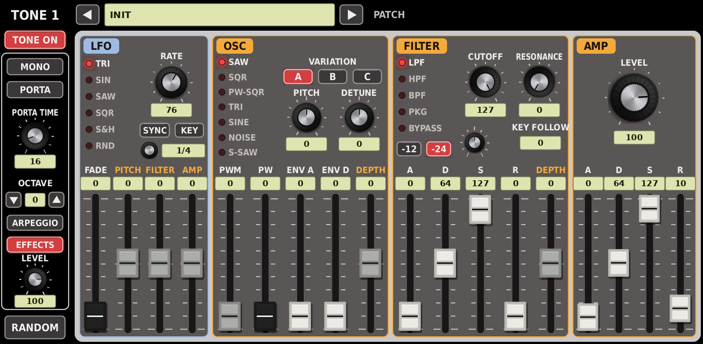
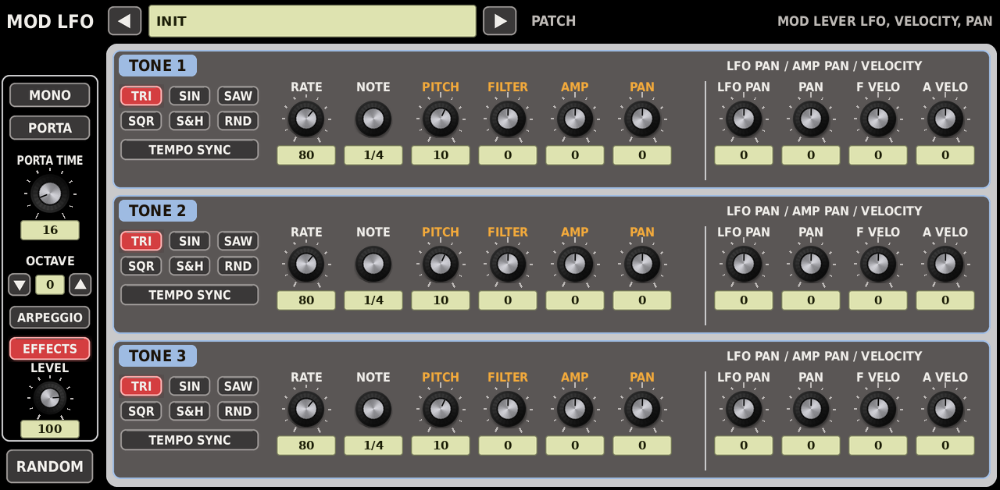
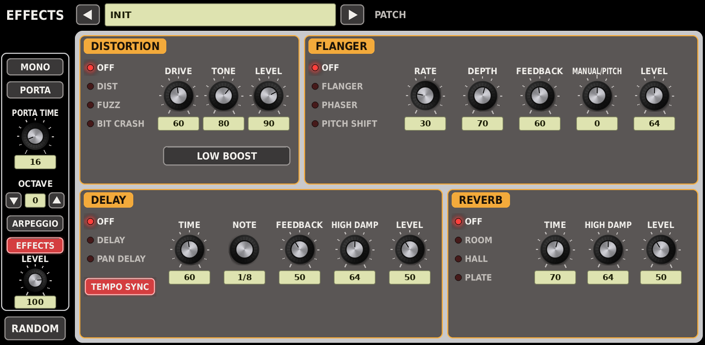
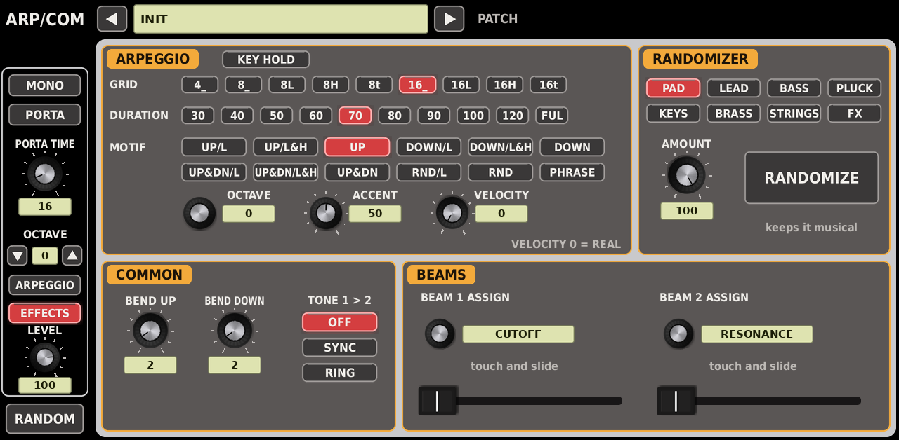

# GAIAXXL v0.1.0



Virtual-analog synth for Akai Force / MPC OS, modelled on the discontinued Roland GAIA SH-01. Every voice was played one
by one on the original and rebuilt in new code from open-source SDKs. Not affiliated with Roland.

A native VST2 instrument for the Akai Force and MPC standalone (MPC OS 3.x), through
[mpc-vst-plugins](https://github.com/sd88me/mpc-vst-plugins). Same parameters as the GAIA's editor, laid out over six
full-screen pages in the editor's colours, with large lettering throughout.

**→ The manual: [docs/USER_GUIDE.md](docs/USER_GUIDE.md)**

## What it is

- **Three tones per voice, eight voices.** Each tone is a full synth: OSC (7 waves x 3 variations), pitch envelope,
  FILTER (LPF, HPF, BPF, PKG, BYPASS at -12 or -24 dB, cutoff, resonance, key follow, ADSR, velocity), AMP (level,
  ADSR, velocity, pan), an LFO (6 shapes, tempo sync, fade, key trigger; to pitch, filter, amp, pan) and a MOD LFO
  under the modulation lever.
- **TONE 1 > 2 SYNC and RING**, MONO and PORTAMENTO, bender ranges, patch octave.
- **The effects chain of the original:** DISTORTION (DIST, FUZZ, BIT CRASH), LOW BOOST, FLANGER (FLANGER, PHASER,
  PITCH SHIFT), DELAY (DELAY, PAN DELAY, tempo sync), REVERB (ROOM, HALL, PLATE).
- **The arpeggiator:** grid (4, 8, 16, shuffled and triplet), duration, the twelve motifs, octave range, accent,
  velocity, key hold; on MPC's tempo and grid.
- **Two BEAMS** in place of the D-Beam: touch strips, each assignable to any of the GAIA's 30 D-Beam destinations.
- **A randomizer that keeps it musical:** pick PAD, LEAD, BASS, PLUCK, KEYS, BRASS, STRINGS or FX and an AMOUNT;
  tones land in consonant intervals, envelopes and filters fit the type, levels are evened out.
- **64 factory patches** in MPC's PRESET menu and on the patch arrows.

### The voices

| Wave | A | B | C |
|---|---|---|---|
| SAW | polyBLEP saw | KORG's band-limited saw tables | two saws an octave apart |
| SQR | square | KORG's band-limited square tables | square + sub-octave |
| PW-SQR | pulse (PW 50..98 %) | pulse + sub-octave pulse | two pulses opening both ways |
| TRI | triangle | KORG wave bank A (PW morphs) | KORG wave bank B (PW morphs) |
| SINE | sine | KORG wave bank C (PW morphs) | two-operator FM (PW = index) |
| NOISE | white | pink (KORG's filter) | red (brown) |
| S-SAW | seven detuned saws (PW = spread) | seven KORG table saws, wider | seven saws + sub-octave saw |

The KORG material is from [logue-sdk](https://github.com/korginc/logue-sdk) (BSD-3-Clause): its band-limited tables,
its user-accessible wave banks A to C and its pink-noise filter, vendored in `src/korg/`.

## The pages

| TONE 1 / 2 / 3 | MOD LFO | EFFECTS | ARP/COMMON |
|---|---|---|---|
|  |  |  |  |

The left column (MONO, PORTA, PORTA TIME, OCTAVE, ARPEGGIO, EFFECTS, LEVEL, RANDOM) and the patch bar are on every page.
Knobs with a pointer are parameters; knobs without one (NOTE, OCTAVE, ASSIGN) step through choices. Fader caps: white for
envelopes, grey for modulation depths, black for the rest.

## Build

```
./build.sh                 # -> build/package/L'Cronx - VST - GAIAXXL/
test/run_tests.sh          # the engine test (x86, ASan/UBSan): every patch, wave, filter, effect, the arp, the randomizer
test/host_test.sh          # mpc-vst-plugins' VST2 host test on the wrapper
test/arm_sim.sh            # the engine test as ARM code, under qemu
```

Needs python3 with Pillow and numpy, gcc, and Zig (`pip install ziglang`). The release zip and installer:
`third_party/mpc-vst-plugins/tools/release.py` (see TESTING.md).

## Status

0.1.0 is offline-tested (x86 and ARM under qemu); it has not yet been played on a Force. Worst case on x86 is 146 us per
128-frame block (eight voices of three super saws with every effect), so the Force should have room; `tools/bench.sh`
on the device gives the real figure.

## License

GPL-3.0-or-later (LICENSE). KORG's tables BSD-3-Clause, the wrapper and framework MIT, the font Bitstream Vera.

GAIA and Roland are trademarks of Roland Corporation. This project is an independent recreation and is not affiliated
with or endorsed by Roland.
